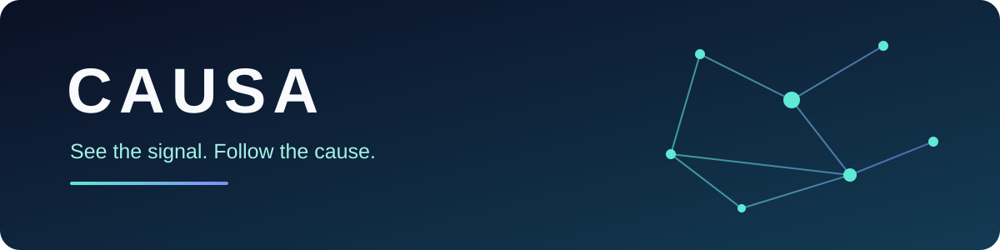
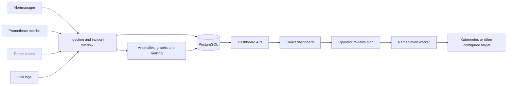
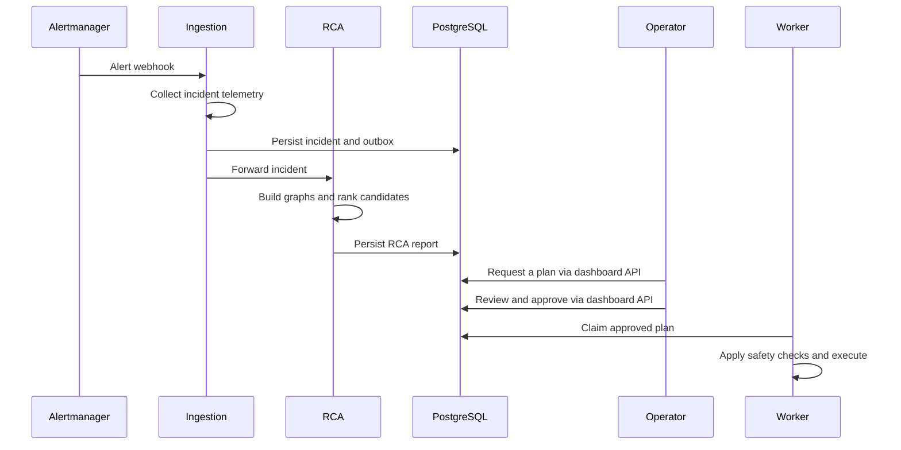

<div align="center">
  
  <h1>Causa</h1>
  <p><strong>From noisy telemetry to an actionable incident story.</strong></p>
  <p> </p>
  <p><a href="#-overview">Overview</a> · <a href="#-how-it-works">How it works</a> · <a href="#-getting-started">Getting started</a> · <a href="#-api--cli-reference">API &amp; CLI</a> · <a href="#-deployment--ci">Deployment</a></p>
</div>

---

## 🔎 Overview

Causa is an observability-driven root-cause analysis system for Kubernetes microservices. It gathers metrics, traces, and logs around an alert, builds an incident influence graph, ranks possible causes, and presents the evidence and proposed remediation to an operator. It is intended for developers and operators investigating distributed-system incidents where a symptom may be far from its cause.

> **Status: development and controlled evaluation.** Automatic remediation is disabled by default. Keep the system proposal-only until the calibration and operational gates in [production readiness](docs/production-readiness.md) are satisfied. Read [SECURITY.md](SECURITY.md) before exposing components beyond a local or isolated cluster.

### ✨ Key features

| Capability | What is in the repository |
| --- | --- |
| Incident ingestion | Alertmanager webhook, scoped telemetry snapshots, and durable incident state. |
| Root-cause analysis | Anomaly detection, topology and influence graphs, isolation, and ranked candidates. |
| Investigation dashboard | Incident inbox and history, graphs, metrics, logs, traces, and remediation review. |
| Remediation | Typed proposals, operator approval, and a worker execution path with safety gates. |
| Evaluation and demos | Golden fixtures, evaluation tooling, an OpenTelemetry demo, and fault examples. |

**Dashboard preview:** TODO: capture a current screenshot and add it as `assets/screenshot.png`.

---

## 🧭 How it works

An alert opens an incident window. Ingestion collects the relevant signals and records incident state; the RCA stage analyzes the evidence and stores its result. The dashboard exposes the incident and a proposed plan to an operator. An approved plan can be claimed by the remediation worker, subject to the configured safety checks.





The ranking score is not automatically a calibrated probability. The repository includes calibration and holdout requirements before automatic action; see [production readiness](docs/production-readiness.md). The detailed RCA contracts and pipeline are in [incident-detection/README_RCA.md](incident-detection/README_RCA.md).

---

## 🧰 Tech stack

| Layer | Tools |
| --- | --- |
| Analysis and services | Python 3.11+, FastAPI, Uvicorn, HTTPX |
| Dashboard | React 18, Vite, React Query, React Flow, Recharts |
| Persistence | PostgreSQL, psycopg |
| Observability | Prometheus, Tempo, Loki, Alertmanager, OpenTelemetry |
| Infrastructure | Kubernetes, Helm, Docker, Kind for the local demo |
| Verification | pytest, Vitest, ESLint, GitHub Actions |

## 🗂️ Project structure

```text
.
├── assets/                  # README banner
├── incident-detection/      # Ingestion, RCA, evaluation, remediation and tests
│   ├── contracts/           # Shared typed interfaces
│   ├── ingest/              # Telemetry adapters and alert trigger
│   ├── rca/                 # RCA orchestration and trigger
│   ├── remediation/         # Plans, approval and worker
│   ├── eval/                # Evaluation and calibration tooling
│   └── helm/                # Observability and Causa charts
├── dashboard/               # FastAPI backend, React frontend and Helm chart
├── incidents/               # Incident ingestion resources
├── demo-bugs/               # Example faults for demo services
├── scripts/                 # Infrastructure and operator helpers
├── tests/                   # Root-level dashboard and integration tests
├── docs/                    # Readiness and operator guidance
├── causa-startup.sh         # Local cluster and dashboard startup
└── microservice-startup.sh  # OpenTelemetry demo startup
```

---

## 🚀 Getting started

### Prerequisites

For the local demo, install Docker, Kind, kubectl, Helm, Python 3.11+ with `venv`, Node.js and npm, `curl`, `lsof`, and `setsid`. CI uses Python 3.12 and Node 22. Startup may download charts and images and modify the configured Kubernetes cluster.

### Configure

From the repository root:

```bash
cp .env.example .env
```

**TODO:** Remove the stray `>>>>>>> 98bf5d4 ...` merge marker from your local `.env` before starting. The checked-in example currently has invalid shell syntax, and `causa-startup.sh` sources the file. Replace example tokens and never commit real credentials. The complete reference is [.env.example](.env.example).

| Variables | Purpose |
| --- | --- |
| `TRIGGER_AUTH_TOKEN`, `STAGE2_AUTH_TOKEN` | Webhook authentication; align tokens with the calling and receiving services. |
| `CAUSA_API_VIEWER_TOKEN`, `CAUSA_REMEDIATION_PROPOSER_TOKEN`, `REMEDIATION_APPROVAL_TOKEN` | Dashboard and remediation access. |
| `PROMETHEUS_URL`, `TEMPO_URL`, `LOKI_URL` | Telemetry backend addresses. |
| `PGHOST`, `PGPORT`, `PGDATABASE`, `PGUSER`, `PGPASSWORD` | PostgreSQL connection; separate remediation role settings are also available. |
| `CAUSA_APP_NAMESPACE`, `CAUSA_PROFILE` | Monitored namespace and profile. |
| `CAUSA_NIM_ENABLED`, `NVIDIA_API_KEY` | Optional NIM-assisted remediation; set the enable flag to `0` to disable it. |
| `CAUSA_REMEDIATION_AUTO_PROPOSE`, `CAUSA_REMEDIATION_AUTO_APPLY` | Automation switches, set to `0` in the example. |
| `CAUSA_TEST_PG_DSN` | Optional test database DSN for PostgreSQL-dependent tests. |

### Run

```bash
./causa-startup.sh
./microservice-startup.sh
```

The first script starts or creates a Kind cluster, deploys the observability stack if needed, installs dashboard dependencies, and starts local processes and port-forwards. It changes the current kubectl context and attempts to stop processes occupying its ports. Open <http://127.0.0.1:5174>; the API defaults to port `8090`, and logs are written under `.run/logs/`. The second script installs the OpenTelemetry demo. `RECREATE_DEMO_NAMESPACE=1` enables a destructive demo namespace reinstall.

<details>
<summary>Frontend-only development</summary>

With the API already available, run:

```bash
cd dashboard/frontend
npm ci
npm run dev
```

Vite listens on port `5174` and proxies `/api` to `localhost:8090`.
</details>

### Install test dependencies and verify

```bash
cd incident-detection
python3 -m venv .venv
.venv/bin/pip install -e '.[dev,trigger]'
.venv/bin/pip install -r requirements-devc.txt
PYTHONPATH=. .venv/bin/pytest -q tests

cd ../dashboard/frontend
npm ci
npm run lint
npm test
npm run build
```

Some Python integration tests require PostgreSQL and `CAUSA_TEST_PG_DSN` and may be skipped without them. [CI](.github/workflows/eval.yml) starts PostgreSQL and loads the rendered schema. From the repository root, `bash scripts/check-prom-rules.sh` checks rendered Prometheus rule packs; it requires Helm and Python, with `promtool` or the script's Docker fallback for full rule validation.

---

## 💻 Usage

Check dashboard process liveness after startup:

```bash
curl http://127.0.0.1:8090/health
```

A successful response is:

```json
{"status":"alive","service":"causa-dashboard"}
```

`/api/health` additionally checks dashboard store initialization and PostgreSQL readiness. Run the fixture evaluation or print a fixture-based remediation plan from `incident-detection/` after installing the test dependencies above:

```bash
PYTHONPATH=. .venv/bin/python -m eval.runner
PYTHONPATH=. .venv/bin/python -m remediation.cli --auto-approve
```

The CLI example prints a typed plan; actual execution is handled separately by the worker. See [incident-detection/README_DEVC.md](incident-detection/README_DEVC.md) for the fixture workflow.

## 📚 API & CLI reference

Dashboard routes below are registered in [dashboard/backend/main.py](dashboard/backend/main.py). For request schemas, query parameters, and the complete list, use the running FastAPI service's `/docs`. Access to protected operations depends on configuration; consult [SECURITY.md](SECURITY.md).

<details>
<summary>Dashboard API routes</summary>

| Method | Path | Purpose |
| --- | --- | --- |
| GET | `/health` | Process liveness. |
| GET | `/api/health` | Store and PostgreSQL readiness. |
| GET | `/api/incidents`, `/api/incidents/history` | Current incidents and history. |
| GET | `/api/incidents/{report_id}`, `/api/incidents/stream` | Incident detail and event stream. |
| POST | `/api/incidents/{report_id}/ack`, `/snooze`, `/feedback` | Incident acknowledgement, snooze, and feedback; each suffix follows `/api/incidents/{report_id}`. |
| GET | `/api/metrics/services`, `/api/metrics/service/{name}/series` | Service metrics and time series. |
| GET | `/api/logs`, `/api/traces`, `/api/traces/{trace_id}` | Logs and traces. |
| GET | `/api/graphs/service-dependency`, `/infrastructure`, `/trace-execution`, `/incident` | Graph views; each suffix follows `/api/graphs`. |
| GET | `/api/alerts`, `/api/stats` | Alerts and dashboard statistics. |
| GET | `/api/remediation/plans`, `/api/remediation/plans/{plan_id}` | List and inspect plans. |
| POST | `/api/remediation/propose`, `/api/remediation/ensure` | Propose or ensure a plan. |
| POST | `/api/remediation/plans/{plan_id}/approve`, `/reject`, `/regenerate` | Review a plan; each suffix follows `/api/remediation/plans/{plan_id}`. |

The ingestion trigger separately exposes `/health` and `/trigger`; see [ingestion documentation](incident-detection/ingest/README.md).
</details>

| Command | Purpose |
| --- | --- |
| `./causa-startup.sh` | Start the local stack and dashboard. |
| `./microservice-startup.sh` | Install or update the OpenTelemetry demo. |
| `PYTHONPATH=. .venv/bin/python -m eval.runner` | Run fixture evaluation from `incident-detection/`. |
| `PYTHONPATH=. .venv/bin/python -m remediation.cli --auto-approve` | Print a fixture-based typed plan from `incident-detection/`. |
| `npm run lint`, `npm test`, `npm run build` | Check and build from `dashboard/frontend/`. |
| `bash scripts/check-prom-rules.sh` | Check Prometheus rules from the repository root. |

---

## 📦 Deployment & CI

Dockerfiles exist for the [dashboard](dashboard/Dockerfile), [ingestion](incident-detection/Dockerfile.ingest), [stage-two RCA](incident-detection/Dockerfile.stage2-rca), and [remediation worker](incident-detection/Dockerfile.remediation-worker). The dashboard, stage-two, and worker Dockerfiles use the repository root as build context; ingestion uses `incident-detection/`. Helm charts are under [incident-detection/helm/](incident-detection/helm/) and [dashboard/helm/](dashboard/helm/).

[GitHub Actions](.github/workflows/eval.yml) runs Python tests with PostgreSQL, frontend lint/tests/build, dependency audits, fixture checks, rules, and Helm lint. Separate remediation workflows are in [.github/workflows/](.github/workflows/). The CD workflow requires configured registry and cluster credentials and skips automatic service builds when no Dockerfile context exists.

## ⚖️ Design decisions & limitations

- Telemetry signals remain distinct, with shared contracts between ingestion, RCA, and downstream components.
- Approval and worker execution are separate; automatic execution requires explicit configuration and calibration gates.
- Fixture evaluation is a smoke check, not proof of production accuracy. Production readiness requires representative labeled incidents and disjoint calibration and holdout sets.
- The checked-in environment example needs the merge-marker correction described above. Cluster access, secrets, persistence, network restrictions, and operational drills require local setup.

## 🗺️ Roadmap

The documented production path includes a versioned labeled corpus, calibration and holdout evaluation, published quality measures, and operational drills. See [production readiness](docs/production-readiness.md) for the gates. TODO: identify a separately maintained feature roadmap.

## 🤝 Contributing

See [CONTRIBUTING.md](CONTRIBUTING.md) for contract, remediation safety, and verification expectations. Report security concerns as described in [SECURITY.md](SECURITY.md).

## 📄 License & acknowledgements

**License:** TODO: no license file or declaration was identified in the repository; confirm terms with the maintainers before reuse.

Causa integrates with the open-source projects named in the tech stack and uses the OpenTelemetry demo for its local scenario. See their respective project documentation for their own licenses and credits.
