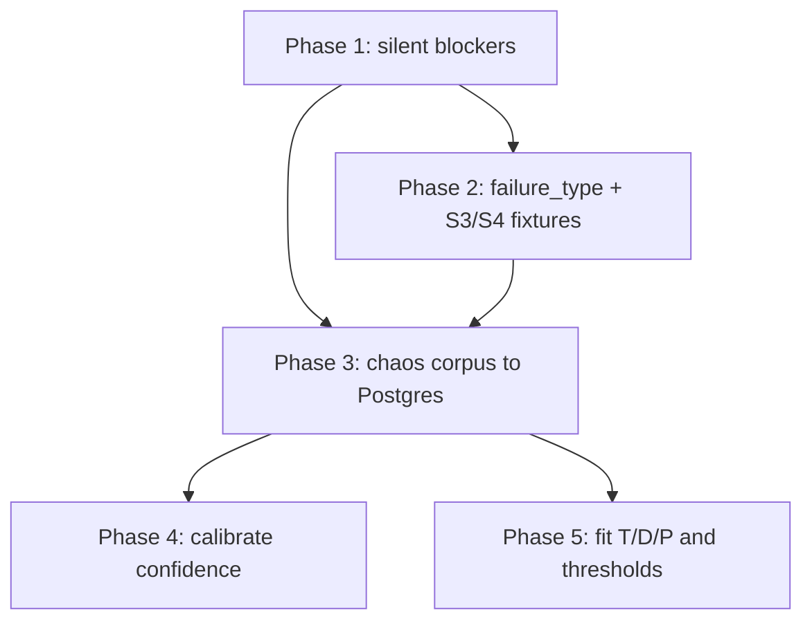

# Dev C integration — gap-fix plan (all six issues)

Plan of record for closing the six open Dev C integration gaps, with corrections
folded in. Companion to [`dev_c_open_issues.md`](dev_c_open_issues.md) (the
checklist) and [`dev_c_handoff.md`](dev_c_handoff.md) (report surface + narrative).

**Context.** A+B→C integration is already verified
([`tests/test_integration_abc.py`](../tests/test_integration_abc.py)). The work is:
(1) prove two silent production paths against real infra, (2) fill offline
fixture / classification gaps, (3) use a chaos corpus to calibrate confidence and
fit constants. Most of the math already exists under [`eval/`](../eval/); what is
missing is **infra proof, wiring, and a real corpus loader**.

## Phase graph

**Critical path & effort (read this first).** Effort is lopsided. **P1a is small
and fully CI-gateable** (dockerized Postgres in CI is trivial). **P1b, P3, P4, P5
all need a live testbed cluster** (Kind + chaos-mesh + otel-demo, or standing
staging) that must be stood up and kept healthy. The real critical path is
**P1a/P1b → P3 → (P4, P5)**, and **P3 is the tent-pole**: ~80% of the risk and
calendar time is "get a real corpus flowing." Do not plan as if the five phases
are comparably sized.

---

## Phase 1 — Silent blockers (must ship first)

### 1a. Postgres `ON CONFLICT` + `uq_rca_incident_id`

Code is likely correct ([`rca/store.py`](../rca/store.py) matches the partial
index in [`helm/postgres/templates/configmap.yaml`](../helm/postgres/templates/configmap.yaml)).
Risk is unverified deploy / missing index.

Concrete work:

- [ ] Extract the `rca_reports` DDL (table + `uq_rca_incident_id`) into a
  loadable SQL file used by **both** Helm init and local tests, e.g.
  `helm/postgres/sql/rca_reports.sql`, included from the ConfigMap via
  `{{ .Files.Get "sql/rca_reports.sql" }}`.
  > **Correction (mechanism):** Helm can only read files **inside the chart
  > root**, so the SQL must live under `helm/postgres/`. Use `.Files.Get`, **not**
  > copy-paste — that is what makes "single source for Helm + tests" actually
  > hold. If it is re-inlined, the test DB and the deployed DB drift.
- [ ] Add a small bootstrap helper (script or pytest fixture) that applies that
  SQL to `CAUSA_TEST_PG_DSN`.
- [ ] Run
  [`tests/test_infra_handoff.py::test_on_conflict_clause_parses_and_is_idempotent`](../tests/test_infra_handoff.py)
  against a throwaway Postgres (local Docker or Kind Postgres).
- [ ] Wire an **opt-in CI job** (dockerized Postgres `service` + apply SQL) so the
  handoff test is not forever skipped. This job has **zero live-infra
  dependency** — land it first.
- [ ] Harden `insert_report`: on a non-duplicate insert failure, log at **ERROR**
  with the SQLSTATE (`exc.sqlstate`). Today a missing index looks like a generic
  insert error.

**Proof:** handoff test green with `CAUSA_TEST_PG_DSN` set.

### 1b. Node-level PromQL

Methods live in
[`ingest/clients/prometheus_client.py`](../ingest/clients/prometheus_client.py)
(`_node_series`, `_range_safe`). Empty series → infra score `0.0` with only a
WARNING.

Concrete work:

- [ ] Confirm the Helm node-exporter relabel (`node` label) in
  [`helm/prometheus/values.yaml`](../helm/prometheus/values.yaml) and that
  `kube_node_info` exposes `internal_ip`.
- [ ] Run `test_node_cpu_and_memory_series_are_nonempty` with `PROMETHEUS_URL` +
  `CAUSA_TEST_NODE`.
- [ ] Make silent failure **observable** without breaking resilient ingest:
  - When both primary and fallback return empty for a requested infra node, log
    **ERROR** (not WARNING) with the query + whether the IP map was empty.
  - Add a counter/metric (or structured log field) `infra_series_empty`.
    > **Correction (alert fatigue):** a genuinely-new or scaled-down node can
    > legitimately have no series → false ERRORs. Make the **`infra_series_empty`
    > metric the alertable signal** (rate-based), not the log line.
  - Keep `_range_safe` swallowing transient Prom errors; **do not** raise in the
    production path.
- [ ] End-to-end:
  `python -m testbed.harness.run_scenario --scenario S5 --node <node> --write-db`
  and confirm the report names the node with `failure_type = 'Infra'`.

**Proof:** handoff Prom test green + S5 smoke.

---

## Phase 2 — Offline gaps that do not need a live corpus

### 2a. Extend `failure_type` (issue 4)

Today [`scoring/fault_class.py`](../scoring/fault_class.py) only assigns
`Infra` / `Dependency` (`NodeKind.DEPENDENCY`) / `Resource`.
[`classify/classifier.py`](../classify/classifier.py) already covers
`AppLogic` / `Config` / `Data` / instrumented `Dependency` via logs + `dev_vector`.

> **Correction (dependency direction — important):** the classifier fill must not
> live in the kernel. If `derive_fault_class()` falls back to `FaultClassifier`
> inside `scoring/` or `rca/`, then **B imports C**, inverting the A/B→C seam.
> The import guard (`test_dev_c_lane_has_no_direct_ab_imports`) will **not** catch
> this — it only scans `classify/remediation/eval` for B-imports, not `scoring/`
> for a C-import. Split issue 4 across the seam, each side using only its own
> evidence:

Chosen approach — **structural floor in B, evidence fill in C**:

- [ ] **Kernel (B), structural only:** keep `derive_fault_class()` as the
  structural assignment. Add an explicit structural rule for the S2 miss:
  a `SERVICE` root whose dominant signals look like caller RED toward a sync
  dependency → `Dependency`, using structural signals the kernel already has.
  **Do not** mirror the classifier's regex/log heuristics here — duplicating that
  logic in two places invites drift.
- [ ] **Dev C (report/write path), evidence fill:** where `failure_type` is still
  NULL, run `FaultClassifier.classify(top_candidate, log_messages=…)` over
  logs / `dev_vector` and use that for `RankedResult.fault_class` /
  `failure_type`. Since B's store writes the `failure_type` column, do this
  **before persistence through a C-owned adapter**, or have C update the column
  on read-back — pick one, but keep the classifier out of the kernel.
- [ ] Thread available log snippets into the classifier at report time if the
  orchestrator already has them; otherwise the classifier still helps via
  `dev_vector`.

**Proof:** S2 fixture / chaos → `failure_type = Dependency`; unit tests for
`AppLogic` / `Config` / `Data` when log/`dev_vector` evidence is present; NULL
still means "not classified", never "no fault".

### 2b. S3 / S4 offline fixtures (issue 5)

Copy the [`fixtures/incident_s2.py`](../fixtures/incident_s2.py) pattern:

- [ ] **S3** (`S3_clock_skew.yaml`): topology around checkout; skewed
  `first_deviation_time`; expectation `fault_class=Timing` (excluded from
  classifier accuracy per contracts).
- [ ] **S4** (`S4_kafka_shared_dep.yaml`): kafka shared async dep with fan-in
  victims, no direct victim–victim edge; expectation `Dependency`.
- [ ] Register both in
  [`testbed/harness/evaluate.py`](../testbed/harness/evaluate.py) `FIXTURES`;
  clear them from `CATALOGUED_WITHOUT_FIXTURE`.
- [ ] Run `python -m testbed.harness.evaluate --check-catalog`.

> **Correction (framing):** these are **regression guards that the paths
> execute**, not accuracy evidence — the offline harness is saturated at
> top1=1.00. Do not let anyone later cite them as accuracy.

**Proof:** evaluate harness exercises S3/S4 paths offline.

---

## Phase 3 — Chaos corpus foundation (unlocks 4 and 6)

Without this, calibration and tuning cannot leave the saturated offline fixtures.

Concrete work:

- [ ] Run chaos scenarios S0–S5 (and D1–D3 if available) via
  [`testbed/harness/run_scenario.py`](../testbed/harness/run_scenario.py) with
  `--write-db` so
  [`groundtruth.ground_truth`](../helm/postgres/templates/configmap.yaml) is
  populated.
- [ ] **Capture scoring inputs, not just `rca_reports` outputs (blocking for P5).**
  > **Correction (verified against the `rca_reports` schema + `store.insert_report`):**
  > `rca_reports` persists **outputs** — per-candidate `signals` (T/D/P),
  > `dev_vector`, `confidence`, `role`, and an `anomaly_scores` dict — but **not**
  > the topology, edges, traces, or the `IncidentSubgraph`. Therefore a loader
  > that only joins `rca_reports ↔ ground_truth`:
  > - **fully unblocks P4 (calibration)** — `(confidence, correct?)` pairs come
  >   straight from `origin_candidates[0].confidence` + the ground-truth join;
  > - **only supports P5 weight tuning in a degraded "re-rank stored signals"
  >   mode** — recomputing `w·[T,D,P]` over the already-pruned top-C set, roles
  >   frozen; it is **not** what `tune_weights` does;
  > - **cannot support threshold / `kappa` / `θ` sweeps at all** — those change
  >   which nodes seed the subgraph and thus the whole candidate set + influence
  >   graph, which needs the raw input.
  >
  > **So Phase 3 must also capture the kernel input per `incident_id`** —
  > serialize `IncidentSubgraph` + `KernelAnomaly` / `AnomalyBag` to a side table
  > or artifact store keyed by incident, **or** make the loader re-read telemetry
  > (Prom/Tempo/Loki) and re-run `rca.adapter`. Until this exists, P5's own proof
  > is unachievable.
- [ ] Implement a Postgres-backed corpus loader for
  [`eval/runner.py`](../eval/runner.py) (today fixture-only): as `causa_eval`,
  join `rca_reports ↔ groundtruth.ground_truth` on `incident_id`, reconstruct
  enough of `(RankedResult, true_root)` **plus** the captured subgraph/anomaly
  inputs above where retuning needs them. The existing
  `tune_weights(scorer, split, anomaly_by_id, subgraph_by_id, …)` signature
  requires `subgraph_by_id` — which only the input-capture step can provide.
- [ ] Use [`eval/splits.scenario_train_test_split`](../eval/splits.py) so
  train/test never leak by scenario.
- [ ] **Collect enough incidents to be statistically meaningful.**
  > **Correction (corpus size):** one full pass of S0–S5 (+D1–D3) is ~9
  > incidents. Isotonic regression on ~9 points, then a scenario-held-out split,
  > yields an ECE that is noise and a calibration map that overfits. Run
  > **repetitions per scenario** (chaos runs vary naturally) to reach N in the
  > dozens+ before P4/P5 numbers mean anything. State a target N and repetition
  > count here, not "≥ one pass."

**Proof:** N incidents (target stated, not "one pass") written with captured
inputs; loader returns train/test pairs without fixtures.

---

## Phase 4 — Calibrate `confidence_score` (issue 3)

Stack already exists: [`eval/calibration.py`](../eval/calibration.py)
(`fit_calibration`, `evaluate_calibration`, `apply_calibrated_confidence`).

Chosen persistence approach:

- [ ] Keep kernel `stamp_confidence()` as raw rank-margin (spec §5).
- [ ] Fit isotonic map on the train split from Phase 3.
- [ ] Persist mapping artifact under `eval/artifacts/calibration_map.json`
  (checked in once stable, or produced by a job).
  > **Correction (provenance):** stamp the artifact with the corpus commit/date
  > that produced it — a calibration map is only meaningful against a known
  > corpus version.
- [ ] Apply the map in the `eval/report` path; optionally load the same map in the
  RCA write path later so `rca_reports.confidence_score` stores calibrated values
  when `CAUSA_CALIBRATION_MAP` is set.
- [ ] Report ECE on held-out test; do **not** treat golden n=1 smoke in
  [`eval/report.py`](../eval/report.py) as proof.

**Proof:** ECE on held-out chaos corpus; mapping artifact + documented apply path.

---

## Phase 5 — Fit T/D/P weights and thresholds (issue 6)

Defaults live in:

- `DEFAULT_WEIGHTS` — [`scoring/scorer.py`](../scoring/scorer.py)
- Role cutoffs / `ALPHA` / `D_PRIOR` — [`scoring/signals.py`](../scoring/signals.py)
- `kappa` / `θ` — [`contracts/anomaly.py`](../contracts/anomaly.py)

Concrete work:

- [ ] Grid-search T/D/P with existing
  [`eval/tuning.tune_weights()`](../eval/tuning.py) on the **chaos** train split
  (not the offline harness — it is saturated at top1=1.00). **Requires the
  captured subgraph/anomaly inputs from Phase 3.**
- [ ] Extend the tuning grid for role thresholds (0.55, 0.45, 0.35), then
  `ALPHA` / `D_PRIOR`; sweep `kappa` / `θ_fire` via anomaly replay **only if the
  corpus captured raw inputs** (see the Phase 3 correction — output-only rows
  cannot support these sweeps).
- [ ] Ship winners as config overrides (Helm values / env / `Thresholds` +
  weights passed into `ABScorer`); leave code defaults as fallback.
- [ ] Validate top-k / MRR on held-out test vs defaults.

> **Correction (null result is a valid "done"):** if the chaos corpus is also
> easy and tuned ≈ defaults, the honest outcome is "defaults confirmed,
> documented." Do not force a weight change to manufacture a delta.

**Proof:** tuned config beats defaults on the `causa_eval` test split (or defaults
are confirmed and documented); values recorded in the open-issues checklist as
done.

---

## Doc / checklist discipline

- Update [`dev_c_open_issues.md`](dev_c_open_issues.md) and the checklist in
  [`tests/test_infra_handoff.py`](../tests/test_infra_handoff.py) as each item is
  proven — **do not mark done until the stated proof command passes.**

## Out of scope / non-goals

- Changing the A+B↔C contract boundary (already guarded).
- Treating offline `evaluate.py` accuracy as real-incident accuracy.
- Making `_range_safe` raise in production (would amplify Prom blips into total
  ingest failure).

---

## Summary of corrections folded in

| # | Correction | Where it lands |
|---|---|---|
| C1 | `rca_reports` stores outputs only; **capture scoring inputs** or P5 cannot re-score (verified) | Phase 3, Phase 5 |
| C2 | Classifier fill must be **C-side**, not in the kernel (B→C inverts the seam; guard won't catch it) | Phase 2a |
| C3 | "One pass" (~9 incidents) is too small; **repeat per scenario** for meaningful ECE/tuning | Phase 3, Phase 4 |
| C4 | Helm DDL must use `.Files.Get` from inside the chart root (not copy-paste) | Phase 1a |
| C5 | Make `infra_series_empty` **metric** the alertable signal, not the ERROR log (alert fatigue) | Phase 1b |
| C6 | S3/S4 fixtures are **regression guards**, not accuracy evidence | Phase 2b |
| C7 | A **null tuning result** (tuned ≈ defaults) is a valid, documented "done" | Phase 5 |
| C8 | Stamp the calibration artifact with its **corpus provenance** | Phase 4 |
| C9 | Name the **critical path**: P1a is CI-only; P1b/P3+ need a live cluster; P3 is the tent-pole | Phase graph |
