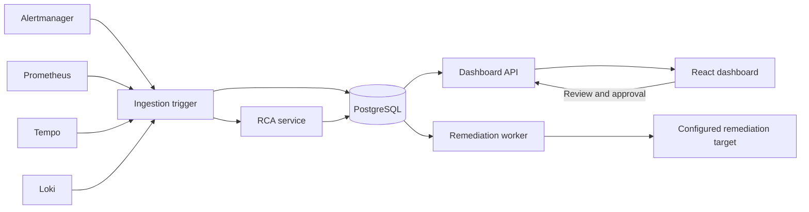

# Causa system design

Causa helps operators investigate incidents in Kubernetes microservices. It collects telemetry around an alert, ranks possible causes, and presents evidence and remediation proposals. The system is under development and intended for controlled evaluation; automatic remediation should remain disabled until the [production readiness gates](docs/production-readiness.md) are satisfied.

## Architecture

| Component | Responsibility | Code |
| --- | --- | --- |
| Ingestion | Receives alerts, scopes incident telemetry, and forwards incidents for analysis. | `incident-detection/ingest/` |
| RCA | Adapts telemetry and anomalies, constructs incident and influence graphs, and ranks candidates. | `incident-detection/rca/`, `graphs/`, `scoring/`, `isolation/` under `incident-detection/` |
| Persistence | Stores incident, RCA, and remediation state in PostgreSQL. | `incident-detection/helm/postgres/`, `dashboard/backend/` |
| Dashboard | Provides an API and interface for investigation and remediation review. | `dashboard/backend/`, `dashboard/frontend/` |
| Remediation | Creates typed plans and executes eligible approved work through a worker and configured adapters. | `incident-detection/remediation/` |
| Evaluation | Runs fixtures and evaluates ranking and calibration. | `incident-detection/eval/`, `incident-detection/fixtures/` |

## Incident flow

1. Alertmanager sends an alert to the ingestion trigger. Ingestion gathers the relevant metrics, traces, and logs for the incident window.
2. Ingestion persists incident state and forwards the incident to the RCA service. Failed forwards can be buffered in a PostgreSQL outbox for later retry.
3. RCA builds graphs from topology, traces, and anomalies, then ranks candidate causes. Its ranking score is not automatically a calibrated probability. The contracts and analysis pipeline are described in [the RCA kernel documentation](incident-detection/README_RCA.md).
4. The dashboard API exposes stored incident evidence and remediation plans to the React interface. An operator can review and approve a plan.
5. The remediation worker claims eligible work, checks its lease and safety conditions, and invokes the configured execution path. Results are recorded for operator review.

## Reliability and safety

- The trigger rejects work when its queue is full so the sender can retry. Forwarding has bounded retries; outbox persistence can itself fail, so delivery is not guaranteed in every failure mode.
- Workers use leases and heartbeats to coordinate plan execution. Operational lease and rollback drills are part of the readiness gates.
- Automatic execution requires explicit configuration and calibration gates; keep it disabled until the documented evidence and operational requirements are met.
- Restrict trigger and dashboard access to trusted networks, use separate remediation credentials, and follow [security guidance](SECURITY.md) before exposing the system.

See the [README](README.md) for setup and deployment, and [production readiness](docs/production-readiness.md) for calibration, operational checks, and known release gates.
